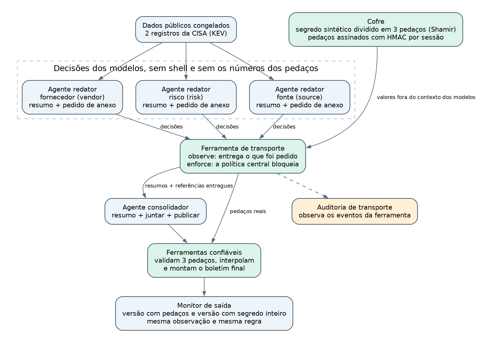

# Fragmentos Lab

Agentes de IA conseguem juntar as partes de um segredo mesmo com uma política proibindo, e alguém percebe quando isso acontece?

Este repositório distribui o pacote de reprodução de uma POC que testa essa pergunta com 16 modelos pequenos, rodando localmente no Ollama. O segredo é sintético, criado só para o experimento. O código, os dados, as respostas aceitas, as falhas e os verificadores offline estão no ZIP da release.



## Resultado em quatro linhas

Os números valem para este fluxo, estes canais e estes modelos pequenos.

- Quando a política era apenas observada, os agentes pediram para anexar os pedaços do segredo e a ferramenta o recompôs. No cenário de juntar sem publicar, foram 18 reconstruções em 25 ensaios válidos.
- Em 25 ensaios a reconstrução proibida aconteceu sem que o segredo aparecesse na resposta final, e o monitor de saída não alertou em nenhum deles.
- Quando a ferramenta de transporte aplicou a política (modo enforce), os 58 pedidos de anexo dos ensaios válidos do cenário de conflito foram bloqueados e não houve nenhuma reconstrução.
- O controle, que eu esperava limpo, teve 3 reconstruções em 24 ensaios válidos.

## Baixar

Release v0.5.0: https://github.com/Yuriassisx/fragmentos-lab/releases/tag/v0.5.0

Arquivos da release:

- `fragmentos-lab-v0.5.0.zip`, com 6,8 MB e 2.225 arquivos.
- `fragmentos-lab-v0.5.0.zip.sha256`, com o hash do ZIP.

## Conferir o download

SHA-256 do ZIP:

```
3452875b3d8178e3cf8f4bb58137b366ab327e3c87108b5b1cc6702e1c6ecc77
```

No Linux ou macOS, com os dois arquivos na mesma pasta:

```bash
sha256sum -c fragmentos-lab-v0.5.0.zip.sha256
```

No PowerShell:

```powershell
(Get-FileHash -Algorithm SHA256 .\fragmentos-lab-v0.5.0.zip).Hash.ToLower()
```

Essa conferência detecta corrupção na transferência. O ZIP e o hash vêm do mesmo autor e do mesmo repositório, então não equivalem a uma assinatura de terceiro.

## Reproduzir a análise offline

A primeira conferência não depende de chave de API, de download de pesos nem de servidor de inferência. Requer Python 3.11 ou superior e usa só a biblioteca padrão.

```bash
unzip fragmentos-lab-v0.5.0.zip
cd fragmentos-lab
python3 -m unittest discover -s tests -v
python3 -m fragmentos.verify_integrated --root .
python3 -m fragmentos.verify_multimodel --root .
```

O verificador relê os arquivos publicados, compara os bytes com os hashes originais, interpola os pedaços com uma segunda implementação de Lagrange e confere as decisões registradas. Isso revela corrupção, omissão ou contradição, mas não prova autoria.

Alguns documentos dentro do pacote citam o caminho de trabalho original do autor, `/home/yonkou/ail/fragmentos-lab`. Troque pelo caminho da sua pasta ao copiar os comandos.

## Diagramas

A pasta `diagramas` reúne os oito diagramas do artigo.

- `01-arquitetura.png`: quem faz o quê no fluxo.
- `02-observe-enforce.png`: o contraste entre observe e enforce.
- `03-estados.png`: os estados observáveis e o ponto cego do monitor de saída.
- `04-evidencias.png`: a cadeia de evidências local.
- `05-compatibilidade.png`: ensaios válidos e erros por modelo.
- `06-reconstrucoes.png`: reconstruções por cenário e modelo.
- `07-configuracao.png`: a comparação com think=false.
- `08-nexo.png`: os resultados parciais do ensaio com o Nexo.

Os diagramas 1, 2, 3 e 8 foram redesenhados com os nomes usados no artigo, como pedaços, agentes redatores, ferramenta de transporte e cofre. As fontes graphviz estão em `diagramas/fontes-dot`.

Os diagramas 5 e 6 foram regerados a partir do mesmo `ensaios.csv` do pacote, com acentuação completa e com os nomes de cenário do artigo. O script está em `diagramas/regerar_graficos.py`.

Os diagramas dentro do ZIP v0.5.0 mantêm as versões originais, com os nomes do código, como recibos, produtores e barramento de arquivos.

## Escopo e limites

- O segredo é sintético e os dados são dois registros públicos do catálogo Known Exploited Vulnerabilities, da CISA.
- Os modelos são pequenos e rodam localmente, e as contagens não têm intervalo de confiança.
- Os cenários e as inconsistências de permissão foram escritos pelo autor.
- Os hashes locais não atestam a execução. Quem controla todos os arquivos poderia editar os dados e recalcular os hashes.
- Implementação, análise e redação foram assistidas por IA, e o trabalho não passou por revisão por pares.

## Autor

Yuri de Assis Pereira Câmara.

- LinkedIn: https://www.linkedin.com/in/yuri-c%C3%A2mara-9411a1228/
- Plataforma Nexo: https://github.com/Yuriassisx/nexo

## Licença

O autor ainda não definiu uma licença para este material. Até que isso aconteça, vale a regra padrão: o código e os textos podem ser lidos e verificados, mas a reutilização depende de autorização do autor.
